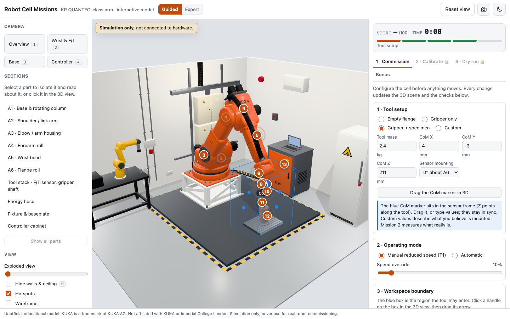

# Robot Cell Missions: interactive 3D viewer

An interactive 3D model of a laboratory robot test cell built around an orange KUKA heavy-payload six-axis arm (KR QUANTEC class), with a force/torque sensor, a specimen fixture and the surrounding lab, plus three hands-on simulation missions: commission the cell, zero and calibrate the F/T sensor, and plan and verify a low-speed dry run.

> **Simulation only.** This is an unofficial educational model. Every dimension, joint limit, sensor value and motion is illustrative. It is not connected to any hardware and must never be used for real robot commissioning, programming or safety assessment.

**Live viewer:** `https://<your-user>.github.io/<this-repo>/` *(fill in after enabling GitHub Pages)*

## Using the viewer

- **Move around:** drag to orbit, scroll or pinch to zoom, right-drag or two-finger drag to pan.
- **Camera presets:** Overview, Wrist & F/T, Base and Controller (keys `1`–`4`).
- **Sections:** pick a part from the list, or click it in the 3D view, to isolate it and read about it.
- **Numbered hotspots:** click one for an explanation; *Focus* flies the camera to it.
- **View options:** exploded view, hide walls (`H`), wireframe, joint axes and an illustrative reach envelope. `R` resets the view.
- **Guided / Expert:** Guided gives hints and explanations; Expert has tighter tolerances and random faults.
- **Mission 1 (Commission):** set up the tool, mode, workspace box and limits; checks explain every problem; lock to unlock Missions 2 and 3.
- **Mission 2 (Calibrate):** jog the arm, diagnose the readings, hold to zero, capture poses, solve by least squares, then torture-test.
- **Mission 3 (Dry run):** pre-flight, your own waypoints, live checks, dead-man's switch (hold the button or Space), E-stop (E key), replay and debrief.
- **Bonus:** Find the Fault, Hotspot Hunt and Reach Test.
- **Sharing:** your settings are saved in the address bar; copy the link to share them.

## Opening it on your own computer

Double-click `index.html`; it works straight from disk, with no internet connection needed.

## Editing the hotspot text

The text in the hotspot cards and the Sections list comes from `assets/hotspots.json`; limits, tool presets, tolerances and scoring come from `assets/config.defaults.json`.

- **To edit:** in GitHub, open that file, click the pencil icon, change the `title`, `body` or `labNote` text, and commit. The live site updates within a minute or two.
- **Keep the JSON valid:** use double quotes and keep the commas between items.
- **Opening from disk** uses a built-in copy of the text and settings. Your edits show on the GitHub Pages site, not when you double-click `index.html`.

## What's in this folder

| Path | Contents |
|---|---|
| `index.html` | The page |
| `js/app.js` | The viewer, with three.js bundled in |
| `js/data.js` | Embedded model and data, used only when the page is opened from disk |
| `assets/` | 3D model (`kuka_lab.glb`), hotspot text, settings (`config.defaults.json`), motion and collision data |
| `css/`, `screenshots/` | Styling and images |
| `src/` | Readable source of the viewer, for reference. The page runs `js/app.js`, so editing `src/` alone changes nothing |

## Credits and licence

- Modelled in Maxon Cinema 4D; viewer built with [three.js](https://threejs.org) r170.
- The code is MIT-licensed. The model, renders and text are licensed CC BY 4.0 (see `LICENSE` and `LICENSE-CC-BY-4.0.md`).

Unofficial educational model. KUKA is a trademark of KUKA AG. Not affiliated with KUKA or Imperial College London.
